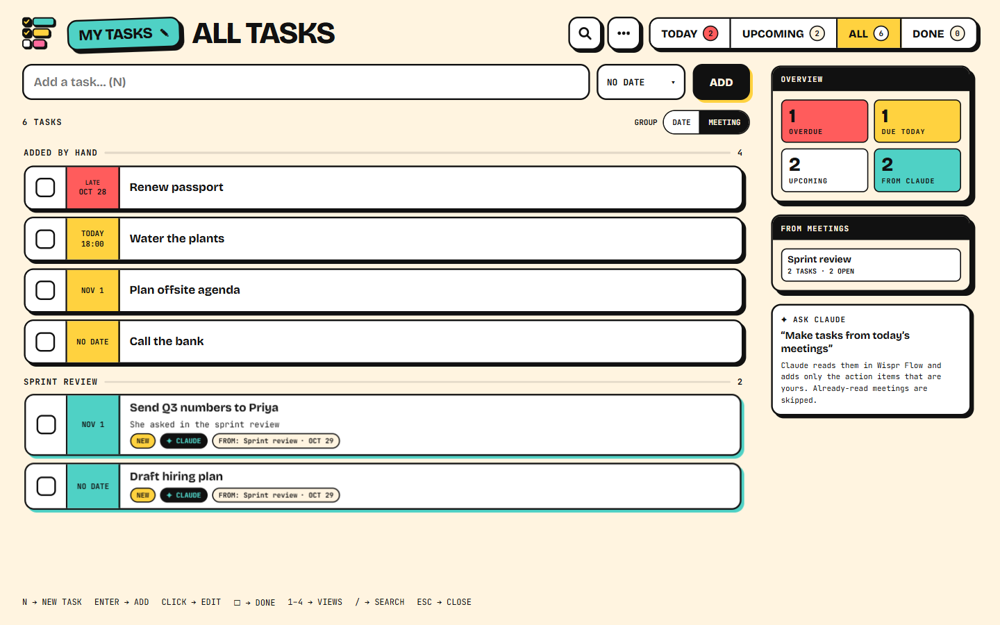
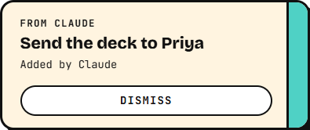
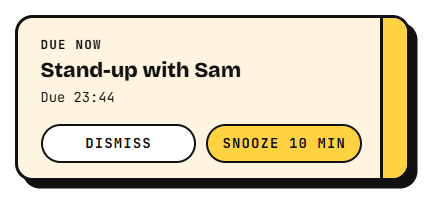
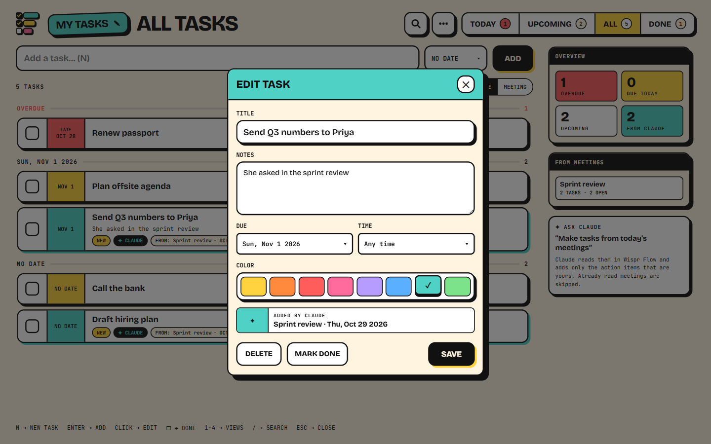

# Slab Tasks

A neobrutalist desktop to-do list for Windows, built on the same base as **Slab** (the calendar): same look, same Electron shell, same tray / start-with-Windows behaviour. It ships with an **MCP server**, so Claude can add tasks to it. Ask Claude to read your meeting notes in Wispr Flow or Granola and it adds only the action items that are yours, by hand or every hour.

```
Claude Desktop / Claude Code
  ├─ Wispr Flow / Granola   → reads meetings, notes, transcripts
  └─ slab-tasks MCP (stdio) → %APPDATA%\Slab Tasks\tasks.json ← Slab Tasks app (watches the file, updates live)
```



<p>
  
  &nbsp;
  
</p>
<p><sub>Left: Claude added a task from chat. Right: a reminder when a task is due. Both pop up from the tray, even with the window closed.</sub></p>

<details><summary>Editing a task</summary>



</details>

## Requirements

- **Windows 10 or 11.** The app is Windows only for now.
- **[Claude Desktop](https://claude.ai/download)**, signed in. Slab Tasks connects to Claude as a Desktop extension.
- **A meeting note taker connected to Claude** *(for tasks from meetings)*. Any note taker that has a Claude connector works: Claude reads your notes through it and adds your action items. The [hourly automation](#automate-it-hourly-scheduled-task) prompt is ready-made for **Wispr Flow** and **Granola**; for others, ask Claude in chat or adapt the prompt's tool names. Connect it in Claude Desktop under **Settings → Connectors**.

You don't need Node.js or any developer tools. Without a note taker you can still add tasks by chatting with Claude.

## Install

1. **Download** from the [latest release](https://github.com/Sri-Harsha-K/slab-tasks/releases/latest):
   - `Slab-Tasks-Setup-<version>.exe`: the app
   - `Slab-Tasks-<version>.mcpb`: the Claude Desktop extension
2. **Run the installer.** It installs for your Windows user, with no admin rights needed. The app opens and adds itself to the Start menu and to start-with-Windows, so it can show pop-ups from the tray.
   - The installer isn't code-signed yet, so Windows may show **"Windows protected your PC"**. Click **More info → Run anyway**.
3. **Keep it running.** Closing the window hides Slab Tasks to the tray (bottom-right, near the clock). To quit, right-click the tray icon → **Quit**.

## Connect Claude Desktop

1. **Install the extension:** double-click `Slab-Tasks-<version>.mcpb`. Claude Desktop opens an install screen. You can also drag the file into **Settings → Extensions**.
2. **Fill in the settings:**
   - **Your name**: as it appears in meetings, e.g. `Alex Rivera`. Claude uses it to add only *your* action items.
   - **Ignore meetings before** *(optional)*: an ISO time such as `2026-10-30T09:00:00Z`. Meetings that started earlier are never turned into tasks automatically. Set it to the moment you start using automation, so your first run doesn't backfill old meetings.
3. Press **Install**, then **restart Claude Desktop**.
4. **Check it:** in a new chat, open the connectors list (the **+** / tools menu). **Slab Tasks** should be listed and switched on, next to your note taker.

### Try it

In a Claude Desktop chat:

- *"Add a task to send the deck to Priya on Friday at 3pm."* The task appears in the app with a **FROM CLAUDE** pop-up, and you get a **DUE NOW** reminder at 3pm.
- *"Make tasks from today's meetings."* Claude reads your note taker, adds only your action items, and tells you what it skipped as someone else's.
- *"What's due today?"* · *"Move the deck task to Monday."* · *"Mark it done."*

### Troubleshooting

- **Slab Tasks isn't in the connectors list:** restart Claude Desktop, then check **Settings → Extensions** that it's installed and enabled.
- **Claude adds other people's action items:** fix **Your name** in the extension settings, using the name people say in meetings. For the hourly automation, also fill in the prompt's `{{NOT_ME}}` / `{{OTHER_PEOPLE}}`.
- **Tasks don't show in the app:** make sure the app is running (tray icon). It reads the same file Claude writes: `%APPDATA%\Slab Tasks\tasks.json`.
- **Updating:** install the new `.exe` over the old one and double-click the new `.mcpb`. Your tasks are kept.

<details><summary>Advanced: Claude Code, manual config, and settings</summary>

**Claude Code**:

```bash
claude mcp add --scope user slab-tasks --env "SLAB_TASKS_OWNER=Your Name" -- node "C:\Users\<you>\AppData\Local\Programs\Slab Tasks\resources\mcp\server.mjs"
```

**Claude Desktop (manual)**: add this to `%APPDATA%\Claude\claude_desktop_config.json` under `mcpServers`, then restart Claude Desktop. Desktop may rewrite this file, so the extension is the more reliable option.

```json
"slab-tasks": {
  "command": "C:\\Program Files\\nodejs\\node.exe",
  "args": ["C:\\Users\\<you>\\AppData\\Local\\Programs\\Slab Tasks\\resources\\mcp\\server.mjs"],
  "env": { "SLAB_TASKS_OWNER": "Your Name" }
}
```

The MCP server is installed with the app at `<install dir>\resources\mcp\server.mjs` and runs on Node.js (v20+) for these two options. In the app, **••• → Copy Claude config** copies the right entry for you.

`SLAB_TASKS_OWNER` is your name as it appears in meetings. Claude uses it to tell your action items from everyone else's.

`SLAB_TASKS_SINCE` (optional, ISO time such as `2026-10-29T21:00:00Z`) stops backfill. When Claude passes a meeting's start time, `check_meetings` lists meetings that started earlier as `old`, and `add_tasks` refuses them. The only exception is when you ask for one of those meetings by name (Claude then passes `allow_old: true`). Set it to the moment you turn on automation. In the extension, this is the **Ignore meetings before** setting.

</details>

## Use it

In Claude, say *"make tasks from today's meetings"*, or pick the **tasks_from_meetings** prompt. Claude then:

1. finds the meetings in Wispr Flow or Granola,
2. skips meetings it has already processed (`check_meetings`),
3. adds only your action items, tagged with the meeting (`add_tasks`; re-running a meeting adds no duplicates),
4. summarises what it added and what it skipped as someone else's.

New tasks show up in the app right away, with a **FROM CLAUDE** pop-up even when the app is in the tray.

You can also ask for one-off tasks, e.g. *"add a task for this on Friday at 3pm"*.

To have this happen on its own every hour, see [Automate it](#automate-it-hourly-scheduled-task).

| MCP tool | What it does |
|---|---|
| `add_tasks` | Add tasks, optionally from a meeting (dedupes, marks the meeting processed) |
| `list_tasks` | `today` / `upcoming` / `all` / `done`, filter by meeting or text |
| `update_task` | Edit title, notes, due, time, colour, done |
| `delete_task` | Remove a task |
| `check_meetings` | Which meetings were already processed, or started before the cutoff |
| `mark_meetings_processed` | Record meetings with nothing for you |
| `start_run` / `finish_run` | Scheduled runs: which meetings to read, and where the next run starts |

## Automate it: hourly scheduled task

A Claude scheduled task can read your new meeting notes every hour and add your action items, with no prompting. It reads Wispr Flow, Granola or both, and only looks at meetings since the previous run.

### What you need

- **Claude Desktop** with the **Slab Tasks extension** installed (see [Connect Claude](#connect-claude-desktop)). In **Settings → Extensions → Slab Tasks**, fill in:
  - **Your name**: as it appears in meetings.
  - **Ignore meetings before**: the time you switch automation on, as an ISO time such as `2026-10-29T21:00:00Z`. Older meetings then never get turned into tasks, so the first run doesn't backfill your whole history.
- At least one **note-taker connector** in Claude: **Wispr Flow** and/or **Granola**. With only one, the prompt skips the other.
- The **Slab Tasks app** installed and running (it starts with Windows), so new tasks pop up as they arrive.

### 1. Fill in the prompt

Copy [`prompts/scheduler-prompt.txt`](prompts/scheduler-prompt.txt) and replace the placeholders:

| Placeholder | What to put | Example |
|---|---|---|
| `{{FULL_NAME}}` | Your name as it appears in calendar invites and notes | `Alex Rivera` |
| `{{CALLED}}` | What people call you in meetings (add nicknames, comma-separated) | `Alex` |
| `{{TIME_ZONE}}` | Your time zone | `Pacific time`, `IST` |
| `{{NOT_ME}}` *(optional)* | Someone easily confused with you | `Alexa (design lead)` |
| `{{OTHER_PEOPLE}}` *(optional)* | Colleagues who often take action items | `Sam, Priya, Jordan` |

If you skip an optional placeholder, delete the sentence it's in. For `{{OTHER_PEOPLE}}`, that's the `(e.g. …)` part.

### 2. Create the scheduled task

In Claude Desktop, open **Scheduled tasks** and create a new one:

- **Prompt**: your filled-in prompt.
- **Schedule**: hourly on working days, at a time that leaves room for notes to finish after meetings end (Wispr Flow takes about 30 minutes). Example: every hour at :45 from 11:45 to 17:45, Monday to Friday (cron `45 11-17 * * 1-5`, in local time).
- **Permissions**: let it use the note-taker and Slab Tasks tools without asking. It runs unattended, so a permission prompt would stall it.
- **Notifications**: optional. The app already pops up **FROM CLAUDE** when tasks are added.

### 3. Test it

Run the task once by hand (**Run now**). Its summary lists:

- the time window it searched,
- the tasks it added, per meeting,
- the items it skipped as someone else's,
- meetings it left for later because their notes weren't finished.

Check the tasks in the app. If it picked up someone else's items, add them to `{{NOT_ME}}` / `{{OTHER_PEOPLE}}` or sharpen the "Who I am" line.

### How it works

- **No duplicates.** Each meeting is processed once. Re-runs skip it (`check_meetings`), and a task you delete never comes back.
- **Only new meetings.** Every run starts with `start_run`, which returns the previous run's checkpoint minus an hour of overlap. Every run ends with `finish_run`, which saves the next checkpoint to `%APPDATA%\Slab Tasks\automation.json`.
- **Unfinished notes wait.** A meeting whose notes aren't finished yet (Wispr `finalized = false`, Granola transcript pending) holds the checkpoint at its start time. The next run picks it up.
- **Failures retry.** A run that fails doesn't save a checkpoint, so the next run retries the same window. A missed run (PC asleep) is covered by the next one.
- **One copy per meeting.** A meeting recorded by both Wispr Flow and Granola is used once: the Wispr copy is preferred, and the other copy is marked processed. Granola ids are stored with a `granola:` prefix.

### Good to know

- It only runs while your PC is on and Claude Desktop is running.
- Each run uses your Claude plan's usage. A run with no new meetings is short.
- To pause it, turn the task off in **Scheduled tasks**. To re-read a meeting on purpose, ask Claude in chat by meeting name. Claude can then override the cutoff (`allow_old`).
- Claude Code works too: `claude mcp add` (above) gives it the same tools. Set `SLAB_TASKS_SINCE` there to match.

## App

- Views: **Today** (overdue + due today), **Upcoming**, **All**, **Done**. Group by date or by meeting.
- Quick add: type and press Enter (Shift+Enter opens the full form). `N` new · `/` search · `1–4` views · `Esc` close.
- Click a task to edit its notes, due date and time, and colour. Click ☐ to complete it.
- Reminders: a task with a date **and** time pops up **DUE NOW** in the corner with a chime when it's due, even when the window is closed (the app keeps running in the tray). If the PC was off or asleep at that time, it shows **MISSED** once when the app is back, but only within 6 hours. Moving a task to a new date or time re-arms its reminder. Pop-ups fade out after 5 seconds; moving the mouse onto one keeps it. Reminders have **Dismiss** and **Snooze 10 min**. Click the pop-up to open the task.
- The side panel shows overdue / today / upcoming / from-Claude counts and the meetings Claude has read.
- Data: `%APPDATA%\Slab Tasks\tasks.json` (••• → Show data file). The app and the MCP server lock the file and write it atomically, so neither overwrites the other's changes.

## Develop

```bash
cd app
npm install
npm start            # build + run in Electron
npm test             # task model + file store
npm run test:mcp     # MCP server over stdio
npm run test:e2e     # real Electron app via Playwright, off-screen and muted (screenshots in test/.out)
npm run brand        # regenerate icons / installer art from src/assets/tasks-mark.svg
npm run dist:win     # installer → app/release/
```

Layout: `shared/` holds the task model and file store, used by both the app and the MCP server. `electron/` is the shell (window, tray, pop-up, IPC). `src/` is the React UI (pickers, toast and styles come from Slab). `mcp/` is the MCP server, bundled to `mcp-dist/` with esbuild.

Not yet linked to Slab. The task file format leaves room for Slab to show due tasks on its calendar later.

## License

MIT. See [LICENSE](LICENSE).
